# Assignment 4 Forms and Validation

## Student information

- Name: Abitay Ainaz
- Group: IT-2502

## Project description

This project implements Assignment 4 for Frontend Development. It demonstrates basic HTML forms, native HTML5 validation, Bootstrap form styling, Bootstrap validation feedback, and a responsive registration form.

## Project structure

```text
assignment4-frontend/
├── index.html
├── styles.css
├── script.js
└── README.md
```

## Assignment parts

### Part 1 Task 0 Simple Contact Form

The first task creates a simple contact form using standard HTML form elements.

The form contains:

- Name text input;
- Email input;
- Message textarea;
- Submit button;
- Label elements for every input.

The `label` elements are connected to the inputs by using the `for` and `id` attributes. This improves accessibility and allows the user to click on the label to activate the field.

The form also uses Bootstrap spacing and button classes to make the layout cleaner.

To test this task, enter a name, email, and message, then click the Send message button. If all fields are completed, the page displays a successful submission message.

Screenshot: 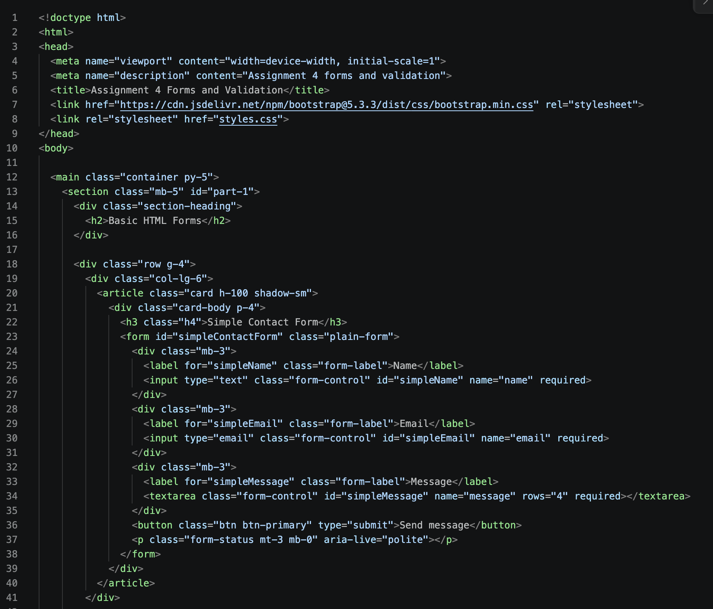
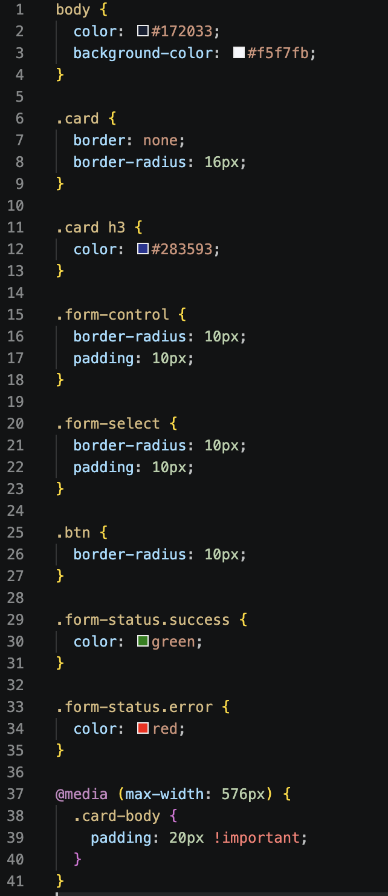

 ### JavaScript Explanation

The script selects the contact form and checks its data using `checkValidity()`.

If the form is invalid, submission stops. If the form is valid, `preventDefault()` prevents page reload, and a success message is displayed in the `.form-status` element.

The `success` class changes the message color to green.

Screenshot: 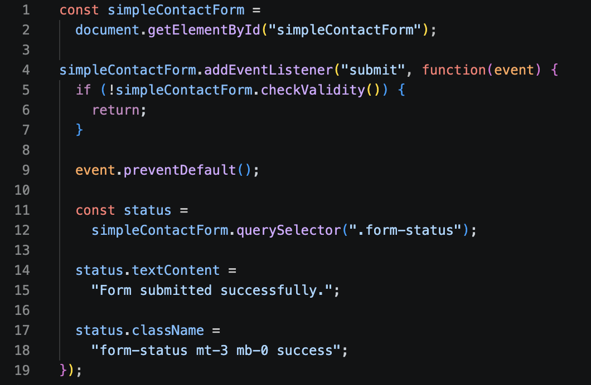

### Part 1 Task 1 Form with HTML5 Validation

The second task demonstrates built-in browser validation. The form uses `required`, `type="email"`, `minlength`, and `maxlength` attributes.

The browser prevents submission when a required field is empty, the email format is invalid, the name is too short, or the message is outside the allowed length. This task shows that basic validation can work without additional JavaScript validation rules.

Screenshot: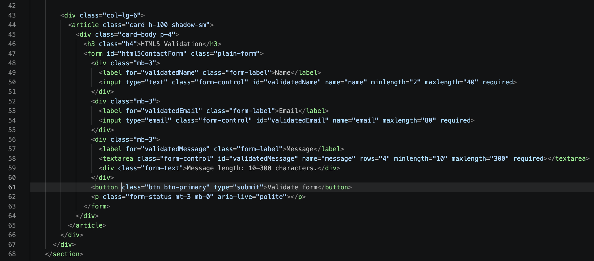 

### JavaScript Explanation

This code selects the HTML5 validation form and checks the entered data.

If the data is invalid, the form is not submitted. If the data is valid, the page does not reload and displays the message `HTML5 validation completed.` in green.

Screenshot: 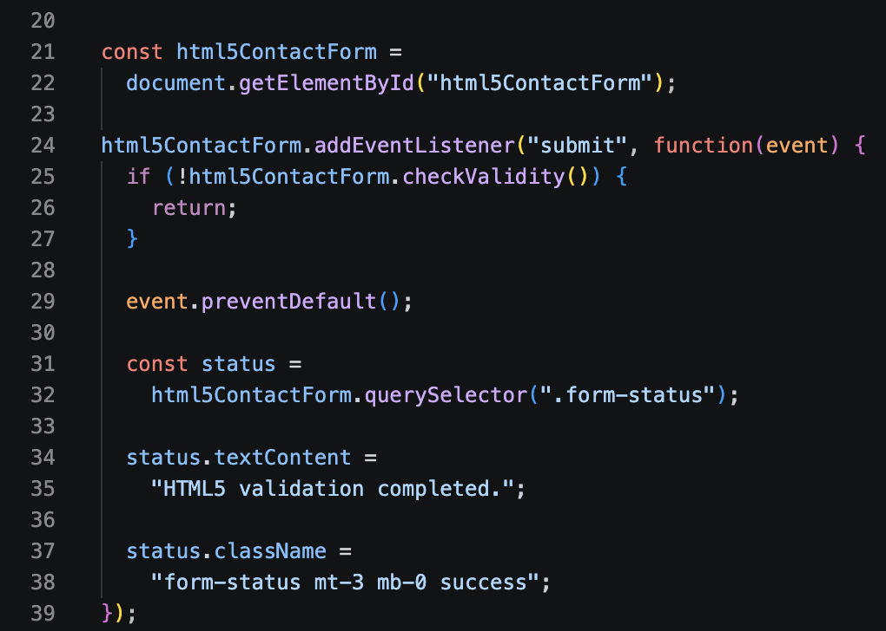

### Task 2 and Task 3 Bootstrap Contact Form

This code creates a Bootstrap-styled contact form.

Bootstrap classes such as `row`, `col-md-6`, `col-12`, `form-control`, and `form-label` make the form responsive and organized.

The form also includes placeholders, helper text, and validation feedback messages.

The `valid-feedback` class displays a success message, while `invalid-feedback` displays an error message when the entered data is incorrect.


Screenshot: 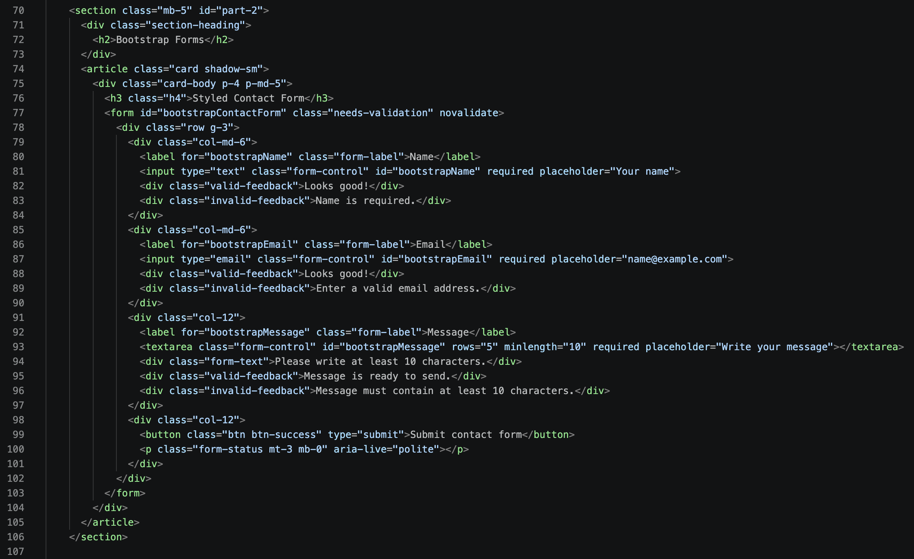

### JavaScript Explanation

This code handles Bootstrap form validation.

When the user submits the form, the `was-validated` class displays Bootstrap validation styles.

If the form is invalid, an error message appears and the invalid fields are highlighted.

If all fields are correct, a success message appears. 

Screenshot: 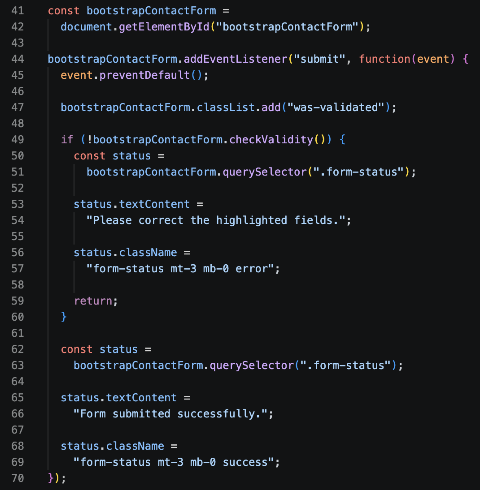

### Part 3 Task 4 Registration Form

The registration form includes first name, last name, email, password, password confirmation, gender radio buttons, hobbies checkboxes, country select, submit button, and reset button. The password must contain at least eight characters, and the confirmation must match the password.

Screenshot: 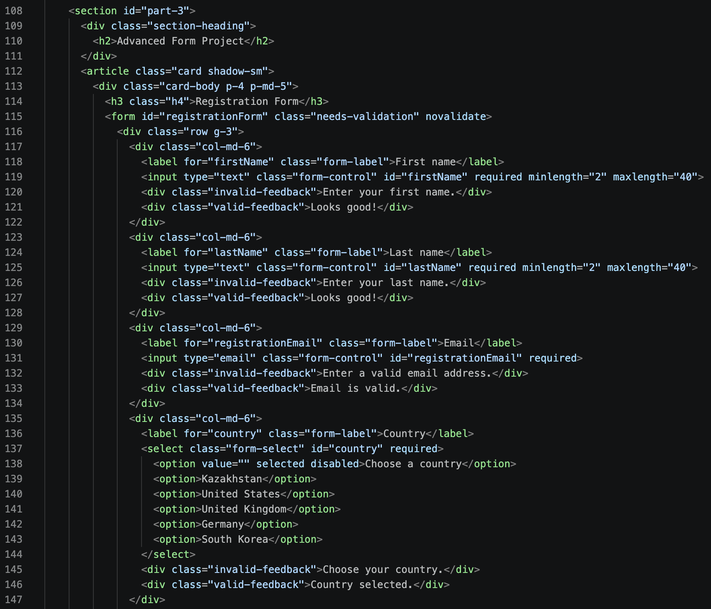 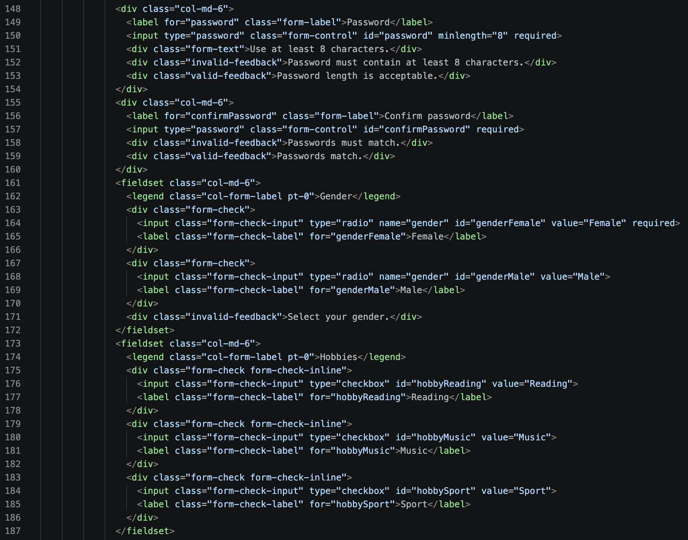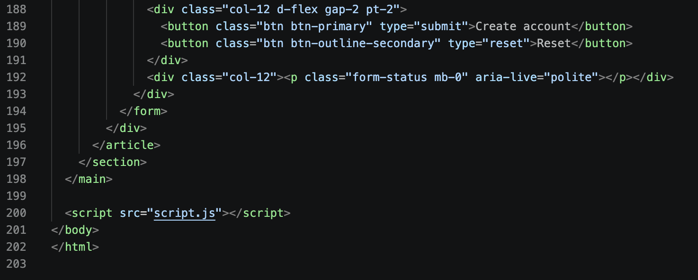

### JavaScript Explanation

This code validates the registration form.

It checks whether both passwords are the same. If they are different, an error message appears.

The `was-validated` class displays Bootstrap validation styles. If the form is invalid, an error message is shown. If all fields are correct, a success message appears.

The password is also checked while the user is typing. The reset button clears the validation messages and returns the form to its initial state.

Screenshot: 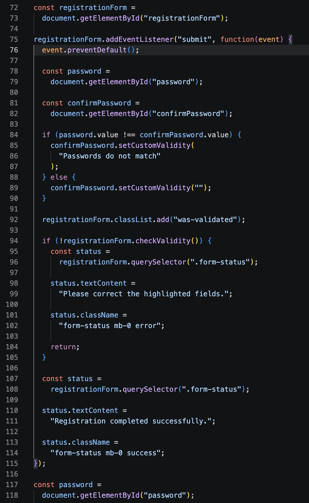 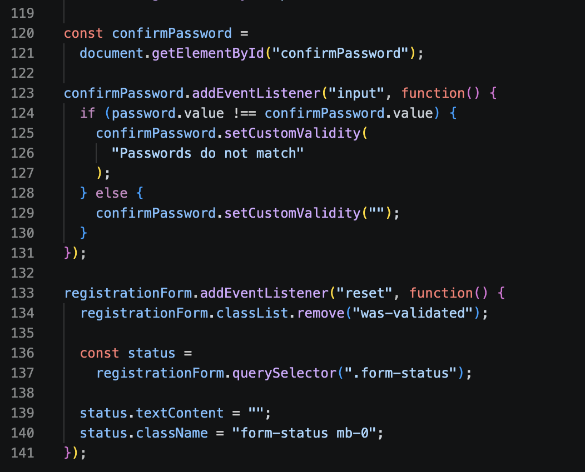


The project uses Bootstrap 5.3 from a CDN, so an internet connection is needed for Bootstrap styles. The HTML and JavaScript still remain in the project and are easy to inspect.

## What each file does

`index.html` contains the page structure, all assignment forms, labels, inputs, validation attributes, Bootstrap classes, and feedback blocks.

`styles.css` adds the page theme, spacing, colors, card layout, responsive adjustments, and status message colors.

`script.js` handles form submission, native validity checks, Bootstrap validation states, success/error messages, password matching, and the reset behavior.

`README.md` documents the assignment parts, setup instructions, project structure, and screenshot locations.

## Work summary

The work was completed by first creating the required HTML forms, then adding HTML5 validation attributes. Bootstrap classes were used to make the forms responsive and visually consistent. JavaScript was added to show Bootstrap validation feedback and to validate matching passwords. The final page groups all tasks into three assignment parts and can be tested directly in a browser.
